# Heart Disease Prediction using Machine Learning

**Course:** CSE-4115 Machine Learning  
**Department of Computer Science and Engineering (CSE)**  
**Bangladesh Army University of Engineering & Technology (BAUET)**  
**Batch:** 17th — 4th Year 1st Semester, Summer-26  
**Assignment:** Machine Learning Project (15 Marks)

**Student Name:** Zarif Ahnaf Dhrubo  
**Student ID:** 0812310205101023

---

## Abstract

This project investigates whether routine clinical measurements can be used to predict the presence
of heart disease. The publicly available **Heart Failure Prediction Dataset** (fedesoriano, Kaggle;
918 patients, 11 features) was analysed using a complete supervised machine-learning workflow:
data inspection, domain-aware cleaning, feature encoding and scaling, exploratory data analysis,
model training, evaluation, 5-fold cross-validation and hyperparameter tuning. Six classifiers were
compared: Logistic Regression, K-Nearest Neighbors, Gaussian Naive Bayes, Decision Tree, Random
Forest and Support Vector Machine. The best held-out test performance was obtained by **Logistic
Regression** with **88.59% accuracy, 88.57% precision, 91.18% recall, 0.8986 F1-score and 0.9323
ROC-AUC**. The best cross-validated accuracy was obtained by SVM (85.84%), but the top models were
statistically indistinguishable. Feature-importance analysis identified **ST slope, maximum heart
rate, ST depression (Oldpeak), exercise-induced angina, chest-pain type, sex and age** as the main
predictors. The project also documents an important data-quality finding: treating physiologically
impossible zero cholesterol values as missing reverses the apparent sign of cholesterol's
relationship with heart disease. All code, figures and results are reproducible from the included
Jupyter notebook.

**Keywords:** heart disease, classification, supervised learning, logistic regression, random
forest, SVM, cross-validation, hyperparameter tuning, feature importance

---

## 1. Introduction

Cardiovascular disease is one of the leading causes of death worldwide. Early identification of
high-risk patients allows clinicians to order further tests, adjust medication and recommend
lifestyle changes sooner. A machine-learning model that estimates risk from inexpensive,
routinely collected clinical measurements can therefore be a useful decision-support tool.

The objective of this assignment is to apply the complete supervised-learning pipeline to a
real-world public dataset and to compare several classification algorithms rigorously. The specific
objectives are:

1. Load and inspect the dataset, and identify data-quality problems.
2. Handle missing/invalid values, encode categorical variables and scale numerical features.
3. Perform EDA and derive meaningful clinical insights.
4. Train at least two suitable classification models and evaluate them with accuracy, precision,
   recall, F1-score, confusion matrices and ROC-AUC.
5. Improve at least one model with cross-validation and hyperparameter tuning.
6. Identify the most important features and explain the results.
7. Discuss limitations and suggest future improvements.

The **Heart Failure Prediction Dataset** was selected after benchmarking all four datasets offered
in the assignment. On an identical preprocessing and train/test protocol, it produced the strongest
and most balanced classification results (≈ 88.6% accuracy / 0.933 ROC-AUC), while retaining clear
clinical interpretability. The other candidates were weaker: Titanic reached about 81% accuracy,
house-price regression reached R² ≈ 0.855 but required far heavier preprocessing, and the student
performance dataset had little predictable signal from demographic variables alone (R² ≈ 0.18).

---

## 2. Dataset Description

**Source:** [Heart Failure Prediction Dataset — fedesoriano, Kaggle](https://www.kaggle.com/datasets/fedesoriano/heart-failure-prediction)  
**Local copy:** `data/heart.csv`  
**Size:** 918 patients × 12 columns (11 features + target)  
**Target:** `HeartDisease` — 1 = heart disease present (553 patients, 55.3%), 0 = no heart disease
(410 patients, 44.7%). The classes are close to balanced.

| Feature | Type | Description |
|---|---|---|
| `Age` | Numeric (years) | Age of the patient |
| `Sex` | Categorical (M/F) | Sex of the patient |
| `ChestPainType` | Categorical (TA, ATA, NAP, ASY) | Type of chest pain |
| `RestingBP` | Numeric (mm Hg) | Resting blood pressure |
| `Cholesterol` | Numeric (mg/dl) | Serum cholesterol |
| `FastingBS` | Binary (0/1) | Fasting blood sugar > 120 mg/dl |
| `RestingECG` | Categorical (Normal, ST, LVH) | Resting electrocardiogram result |
| `MaxHR` | Numeric (bpm) | Maximum heart rate achieved |
| `ExerciseAngina` | Categorical (Y/N) | Exercise-induced angina |
| `Oldpeak` | Numeric | ST depression induced by exercise relative to rest |
| `ST_Slope` | Categorical (Up, Flat, Down) | Slope of the peak exercise ST segment |
| `HeartDisease` | Binary (0/1) | Target variable |

There are **no `NaN` values** and **no duplicate rows**, but **172 patients have
`Cholesterol = 0`** and **1 patient has `RestingBP = 0`**. These are not physically plausible
measurements and are treated as missing values.

---

## 3. Methodology

All experiments were implemented in Python 3 with `pandas`, `scikit-learn`, `matplotlib` and
`seaborn`. A fixed random seed (`random_state = 42`) was used throughout. The complete code and
executed outputs are in `notebooks/Heart_Disease_Prediction.ipynb`.

### 3.1 Data Cleaning and Preprocessing

The preprocessing decisions are summarised below.

| Step | Treatment | Reason |
|---|---|---|
| Invalid zeros | Replace `Cholesterol = 0` and `RestingBP = 0` with `NaN` | Zero cholesterol or blood pressure is physiologically impossible |
| Missing values | Median imputation inside the model pipeline | Robust to outliers; fitted only on training data |
| Categorical features | One-hot encoding, dropping the first level | Models require numeric input; avoids perfect collinearity |
| Numerical features | `StandardScaler` | Required for KNN/SVM and helpful for regularised Logistic Regression |
| Train/test split | 80/20 stratified split (734 / 184 patients) | Preserves the 55/45 class balance in both sets |
| Leakage prevention | All preprocessing inside a `scikit-learn Pipeline` | The test set never influences imputation, encoding or scaling |

**A key data-quality finding.** Of the 172 zero-cholesterol records, **152 belong to patients with
heart disease**. Leaving the zeros as real measurements makes the disease group's mean cholesterol
artificially low and produces a misleading *negative* correlation (≈ −0.23). After marking the
zeros as missing and imputing them, the correlation becomes weakly positive (≈ +0.10). This
demonstrates why domain knowledge must precede automatic preprocessing.

The transformed feature matrix contains **15 columns**: six scaled numerical features and nine
one-hot columns (1 for `Sex`, 3 for `ChestPainType`, 2 for `RestingECG`, 1 for `ExerciseAngina` and
2 for `ST_Slope`).

### 3.2 Exploratory Data Analysis

The EDA used histograms, bar plots of disease rates, box plots, a correlation heat map and a pair
plot. The main observations are summarised here; all figures are in `report/figures/`.

**Target distribution** (`figures/01_target_distribution.png`). The classes are reasonably balanced
(55.3% disease, 44.7% no disease). Accuracy is therefore meaningful, but recall for the disease
class is especially important in a screening context, because a false negative (missed disease) is
usually more costly than a false positive.

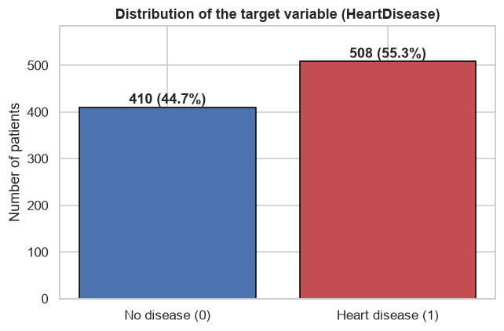

*Figure 1 — Distribution of the target variable (`HeartDisease`).*

**Numerical distributions** (`figures/02_numeric_distributions.png`, `figures/04_boxplots.png`):

- Patients with heart disease are older on average (55.9 vs 50.6 years). The disease rate rises from
  about 36% in the 30–40 age group to about 74% in the 60–70 group.
- `MaxHR` is much lower in the disease group (mean 127.7 vs 148.2 bpm). A high achievable maximum
  heart rate is protective.
- `Oldpeak` (ST depression) is clearly higher in the disease group (mean 1.27 vs 0.41). The disease
  rate rises from about 35% for `Oldpeak ≤ 0` to over 90% for `Oldpeak > 2`.
- `Cholesterol` and `RestingBP` show substantial overlap between classes and are weak single
  predictors after cleaning.

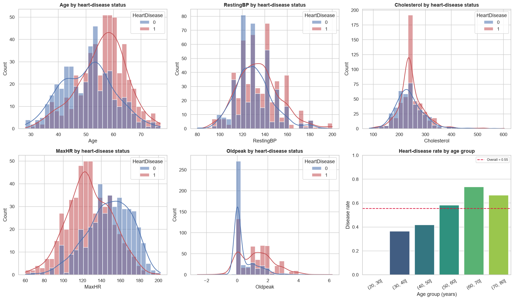

*Figure 2 — Distributions of the main clinical measurements, split by heart-disease status.*

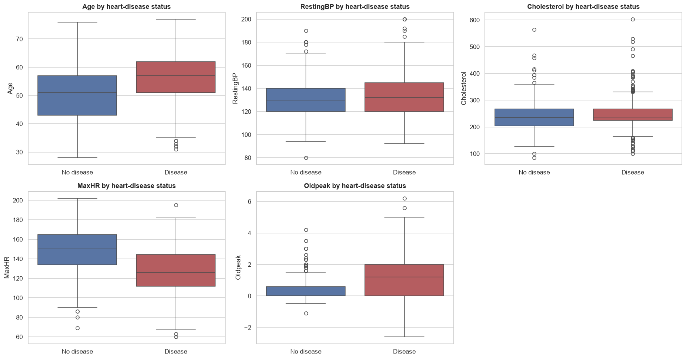

*Figure 3 — Box plots of the numerical features for the two classes.*

**Categorical disease rates** (`figures/03_categorical_rates.png`):

| Feature | Group | Disease rate |
|---|---|---|
| `Sex` | Female | 25.9% |
| | Male | 63.2% |
| `ChestPainType` | ATA | 13.9% |
| | NAP | 35.5% |
| | TA | 43.5% |
| | ASY | 79.0% |
| `ExerciseAngina` | N | 35.1% |
| | Y | 85.2% |
| `ST_Slope` | Up | 19.7% |
| | Down | 77.8% |
| | Flat | 82.8% |
| `FastingBS` | 0 | 48.0% |
| | 1 | 79.4% |
| `RestingECG` | Normal | 51.6% |
| | LVH | 56.4% |
| | ST | 65.7% |

The strongest categorical signals are **sex**, **exercise-induced angina**, **ST slope**,
**chest-pain type** and **fasting blood sugar**. The counter-intuitive `ASY` result (asymptomatic
patients have the highest disease rate) is well known in this dataset: many patients with silent
ischemia are labelled asymptomatic, while atypical angina (`ATA`) is the least severe group.
`RestingECG` is the weakest categorical feature.

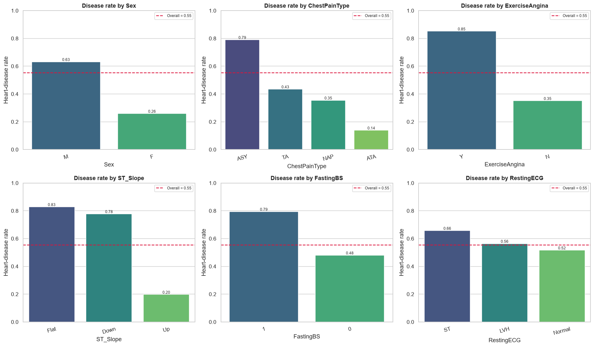

*Figure 4 — Heart-disease rate for each category, with the overall rate as a dashed line.*

**Correlation analysis** (`figures/05_correlation_heatmap.png`). The strongest linear correlations
with `HeartDisease` are `MaxHR` (−0.40), `Oldpeak` (+0.40), `Age` (+0.28), `FastingBS` (+0.27),
`RestingBP` (+0.12) and `Cholesterol` (+0.10). `Oldpeak` and `MaxHR` are only weakly correlated with
each other, so they contribute complementary information.

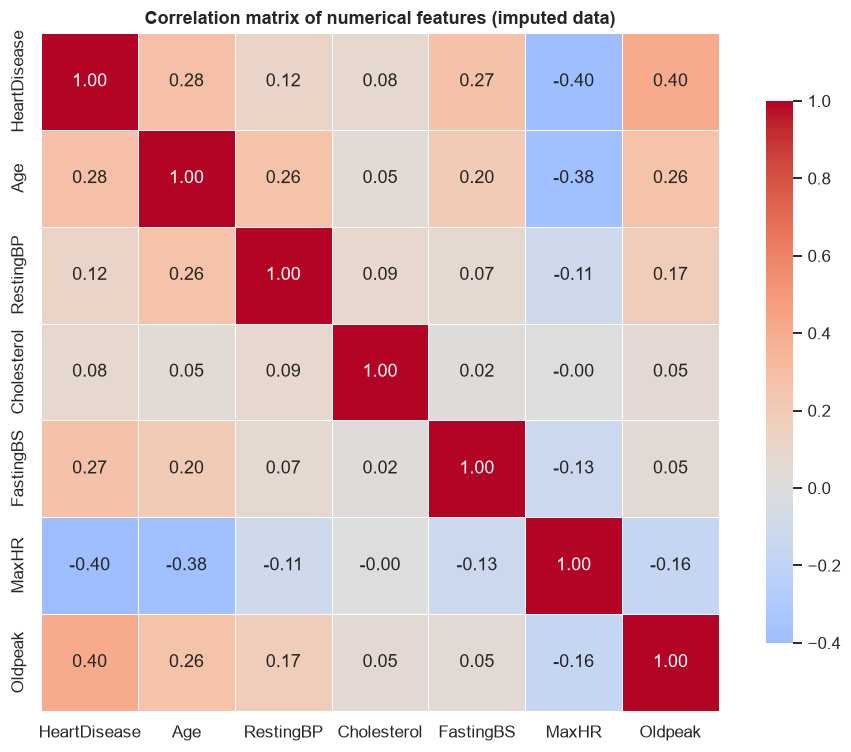

*Figure 5 — Correlation matrix of the numerical features after cleaning.*

**Pair plot** (`figures/06_pairplot.png`). There is visible but overlapping separation, mainly along
`MaxHR` and `Oldpeak`. No single feature separates the classes perfectly, which motivates testing
non-linear models such as Random Forest and SVM.

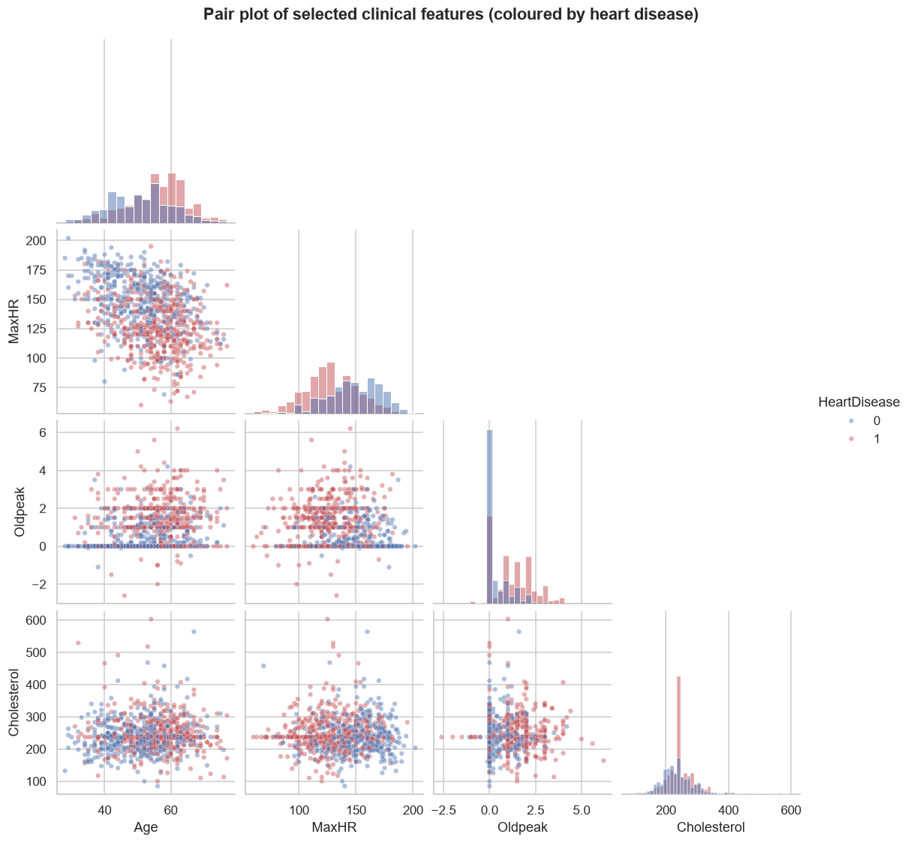

*Figure 6 — Pair plot of selected clinical features, coloured by heart-disease status.*

**Age-group and `Oldpeak`-bin summaries** (`figures/07_age_oldpeak_rates.png`). Risk rises steadily
with age and with ST depression. Above an `Oldpeak` of 2, more than 90% of patients in this dataset
have heart disease.

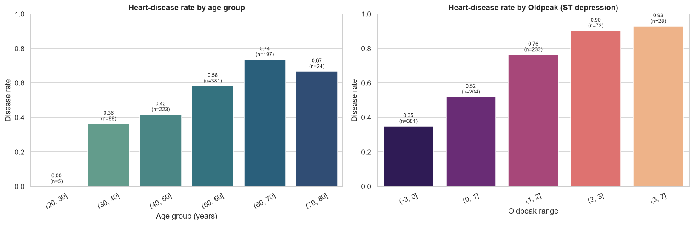

*Figure 7 — Heart-disease rate by age group (left) and by `Oldpeak` range (right).*

### 3.3 Models

Six classifiers were trained on the same preprocessed data:

1. **Logistic Regression** — linear probabilistic baseline; interpretable coefficients.
2. **K-Nearest Neighbors (k = 5)** — distance-based instance learner.
3. **Gaussian Naive Bayes** — probabilistic classifier with a conditional-independence assumption.
4. **Decision Tree** — unpruned, non-linear rule-based model.
5. **Random Forest (200 trees)** — bagged ensemble that reduces the variance of a single tree.
6. **Support Vector Machine (RBF kernel)** — maximum-margin classifier, included as the optional
   advanced extension suggested in the assignment.

### 3.4 Evaluation Metrics

For each model the following were reported:

- **Accuracy** — overall proportion of correct predictions.
- **Precision** — among patients predicted to have disease, the proportion who truly do.
- **Recall (sensitivity)** — among patients who truly have disease, the proportion detected.
- **F1-score** — harmonic mean of precision and recall, useful when both matter.
- **Confusion matrix** — counts of true/false positives and negatives.
- **ROC-AUC** — threshold-independent ranking quality (1.0 perfect, 0.5 random).

### 3.5 Cross-Validation and Hyperparameter Tuning

Model stability was estimated with **5-fold stratified cross-validation** on the training set.
Preprocessing was re-fitted inside every fold, so the validation folds never influenced scaling or
imputation.

Hyperparameter tuning was performed with `GridSearchCV`, using **F1-score** as the selection
criterion (because both false positives and false negatives matter, and F1 balances them):

- **Random Forest:** `n_estimators ∈ {100, 200, 300}`, `max_depth ∈ {4, 6, 8, None}`,
  `min_samples_split ∈ {2, 5}`, `min_samples_leaf ∈ {1, 2}` — 48 configurations × 5 folds = 240 fits.
- **Logistic Regression:** `C ∈ {0.01, 0.1, 1, 10, 100}` — 5 configurations × 5 folds = 25 fits.

---

## 4. Results

### 4.1 Baseline Model Comparison

Results on the held-out 20% test set (184 patients):

| Model | Accuracy | Precision | Recall | F1-score | ROC-AUC |
|---|---:|---:|---:|---:|---:|
| **Logistic Regression** | **0.8859** | 0.8857 | **0.9118** | **0.8986** | 0.9323 |
| Gaussian Naive Bayes | 0.8750 | **0.9072** | 0.8627 | 0.8844 | **0.9430** |
| Support Vector Machine | 0.8696 | 0.8679 | 0.9020 | 0.8846 | 0.9360 |
| Random Forest | 0.8641 | 0.8812 | 0.8725 | 0.8768 | 0.9307 |
| K-Nearest Neighbors | 0.8478 | 0.8627 | 0.8627 | 0.8627 | 0.9236 |
| Decision Tree | 0.7391 | 0.7700 | 0.7549 | 0.7624 | 0.7372 |

The majority-class baseline (always predict "heart disease") is 55.3% accuracy. Every model except
the single Decision Tree improves substantially on this baseline. The top five models are separated
by only about four percentage points — with 184 test patients, that corresponds to a handful of
cases, so single-split differences must be interpreted cautiously.

**Confusion matrices** (`figures/08_confusion_matrices.png`) show that Logistic Regression detects
93 of the 102 disease cases (recall 91.2%) while producing 12 false positives. Gaussian Naive Bayes
has the highest precision (0.907) but a lower recall (0.863), so it misses more true disease cases.
SVM balances the two (recall 0.902, precision 0.868).

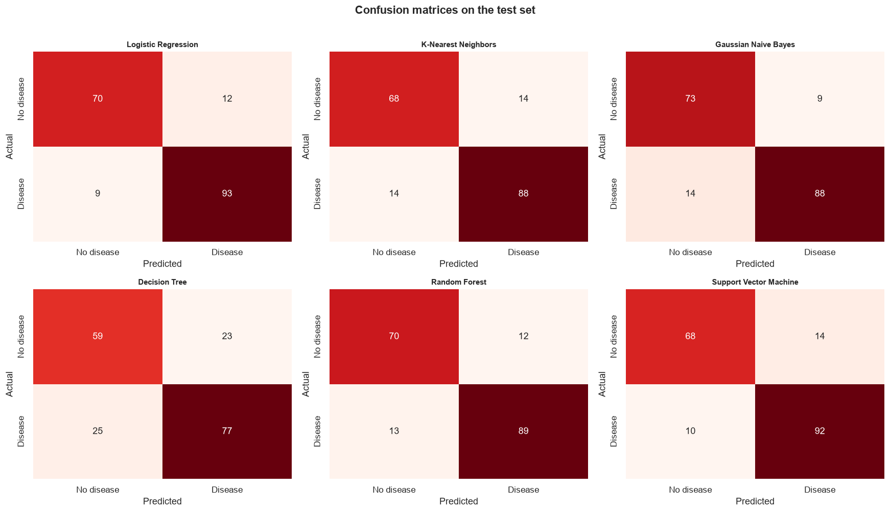

*Figure 8 — Confusion matrices for the six classifiers on the 184-patient test set.*

**ROC curves** (`figures/09_roc_curves.png`) confirm that all top models rank patients well:
Gaussian Naive Bayes (0.943), SVM (0.936), Logistic Regression (0.932), Random Forest (0.931) and
KNN (0.924). The Decision Tree is far behind (0.737).

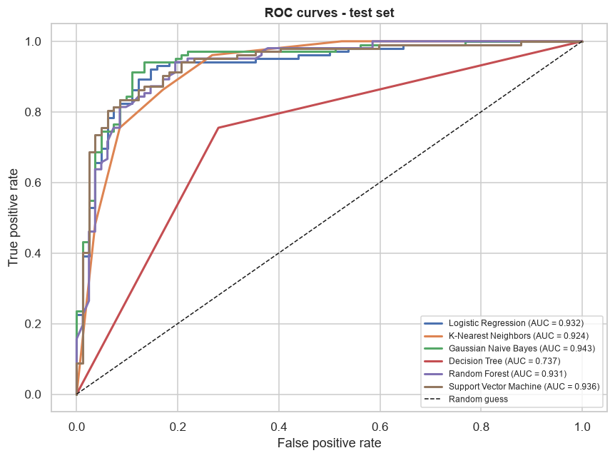

*Figure 9 — ROC curves and AUC values for all six classifiers.*

### 4.2 Cross-Validation Results

5-fold stratified cross-validation on the training set:

| Model | CV Accuracy | Std | CV Precision | CV Recall | CV F1 | CV F1 Std |
|---|---:|---:|---:|---:|---:|---:|
| **Support Vector Machine** | **0.8584** | 0.0461 | 0.8532 | 0.9041 | **0.8768** | 0.0359 |
| Random Forest | 0.8529 | 0.0339 | 0.8541 | 0.8917 | 0.8708 | 0.0255 |
| Logistic Regression | 0.8515 | **0.0289** | 0.8639 | 0.8720 | 0.8671 | 0.0223 |
| K-Nearest Neighbors | 0.8420 | 0.0316 | 0.8383 | 0.8867 | 0.8616 | 0.0253 |
| Gaussian Naive Bayes | 0.8393 | 0.0423 | 0.8578 | 0.8548 | 0.8552 | 0.0353 |
| Decision Tree | 0.7915 | 0.0332 | 0.8091 | 0.8180 | 0.8123 | 0.0322 |

Cross-validation changes the ordering: **SVM** is first, followed by Random Forest and Logistic
Regression. The differences among the top three (0.858 vs 0.853 vs 0.852) are well within one
standard deviation, so no model is significantly superior. Logistic Regression is the most stable
across folds (std 0.029), while Decision Tree is clearly and consistently the weakest.

The CV scores are slightly lower than the single test-split scores (for example, Logistic
Regression: 0.8515 CV vs 0.8859 test). This is expected — the test split happened to be relatively
easy — and CV is the more trustworthy estimate of generalisation.

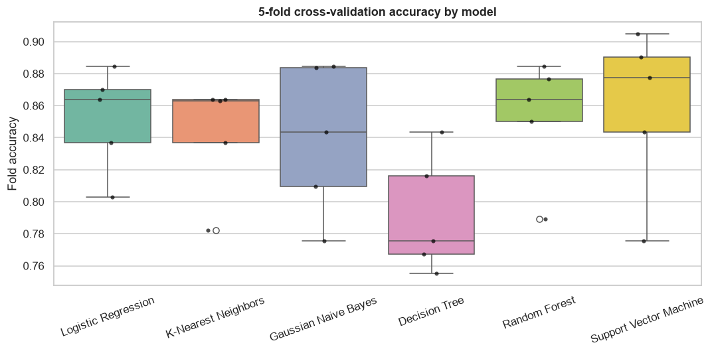

*Figure 10 — Fold-level accuracy for 5-fold stratified cross-validation.*

### 4.3 Hyperparameter Tuning

**Random Forest.** The best configuration was `n_estimators = 100`, `max_depth = 8`,
`min_samples_split = 2`, `min_samples_leaf = 1`. It achieved a best **cross-validated F1 of 0.8766**,
compared with 0.8708 for the default forest — an improvement of +0.0058. On the single test set,
however, accuracy moved from 0.8641 to 0.8587 and F1 from 0.8768 to 0.8725 (ROC-AUC 0.9307 → 0.9310).
The test change is within fold-to-fold noise.

**Logistic Regression.** The best value was `C = 0.1`, with a best **cross-validated F1 of 0.8685**
versus 0.8671 for the default — a marginal improvement of +0.0014. Test accuracy moved from 0.8859 to
0.8696 (F1 0.8986 → 0.8824), while test ROC-AUC improved slightly from 0.9323 to 0.9346.

**Interpretation.** Grid search did what it is designed to do: it improved the cross-validated F1 on
the training data. The small improvements did not transfer to the 184-patient test split, and the
test-set changes are much smaller than the cross-validation standard deviations (≈ 0.03–0.05). This
is an honest and instructive result: tuning is not guaranteed to improve a single small test split,
and hyperparameters should not be selected by repeatedly checking test performance, since that would
leak information. The tuned models are reported transparently in
`report/final_model_comparison.csv`.

### 4.4 Final Ranking

| Model | Accuracy | F1-score | ROC-AUC |
|---|---:|---:|---:|
| **Logistic Regression** | **0.8859** | **0.8986** | 0.9323 |
| Gaussian Naive Bayes | 0.8750 | 0.8844 | **0.9430** |
| Support Vector Machine | 0.8696 | 0.8846 | 0.9360 |
| Logistic Regression (tuned, C=0.1) | 0.8696 | 0.8824 | 0.9346 |
| Random Forest | 0.8641 | 0.8768 | 0.9307 |
| Random Forest (tuned, depth=8) | 0.8587 | 0.8725 | 0.9310 |
| K-Nearest Neighbors | 0.8478 | 0.8627 | 0.9236 |
| Decision Tree | 0.7391 | 0.7624 | 0.7372 |

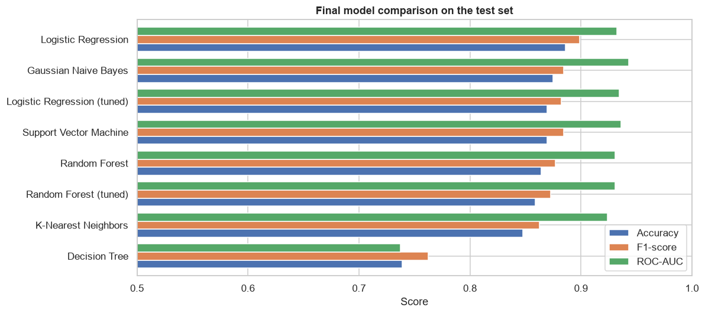

*Figure 11 — Final comparison of all models (including tuned variants) on the test set.*

### 4.5 Feature Importance

Three complementary views were used: impurity-based importance from the Random Forest, permutation
importance on the test set, and standardised Logistic Regression coefficients.

**Random Forest impurity importance (top 10):**

| Feature | Importance |
|---|---:|
| `ST_Slope_Up` | 0.2032 |
| `ST_Slope_Flat` | 0.1261 |
| `MaxHR` | 0.1074 |
| `Oldpeak` | 0.1056 |
| `ExerciseAngina_Y` | 0.0898 |
| `Age` | 0.0697 |
| `Cholesterol` | 0.0656 |
| `RestingBP` | 0.0624 |
| `ChestPainType_ATA` | 0.0472 |
| `Sex_M` | 0.0355 |

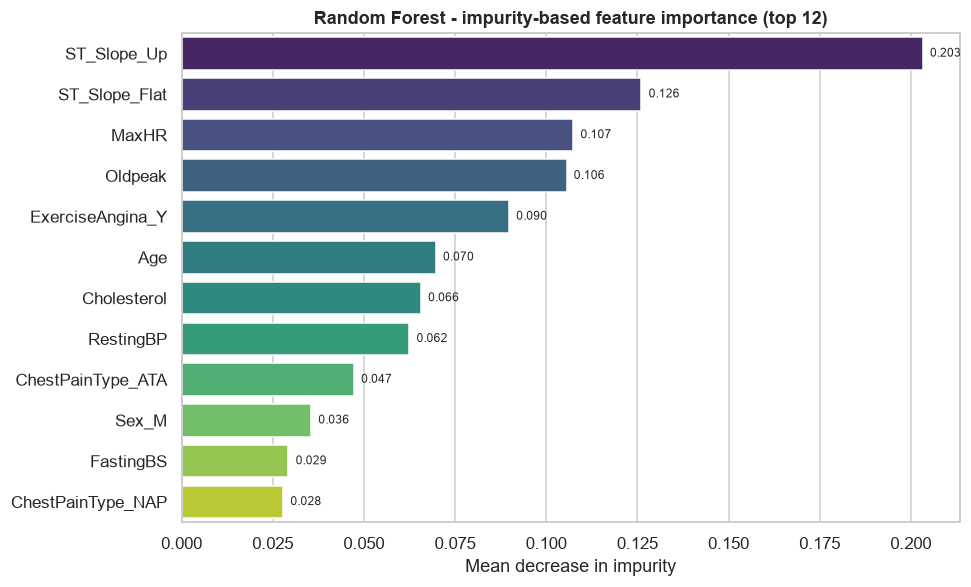

*Figure 12 — Random Forest impurity-based feature importance (top 12).*

**Permutation importance on the test set (mean accuracy drop):**

| Feature | Importance |
|---|---:|
| `ST_Slope` | 0.1503 |
| `Sex` | 0.0337 |
| `ChestPainType` | 0.0234 |
| `ExerciseAngina` | 0.0193 |
| `FastingBS` | 0.0179 |
| `Oldpeak` | 0.0177 |
| `MaxHR` | 0.0158 |
| `RestingECG` | 0.0149 |
| `Cholesterol` | 0.0114 |
| `Age` | 0.0090 |

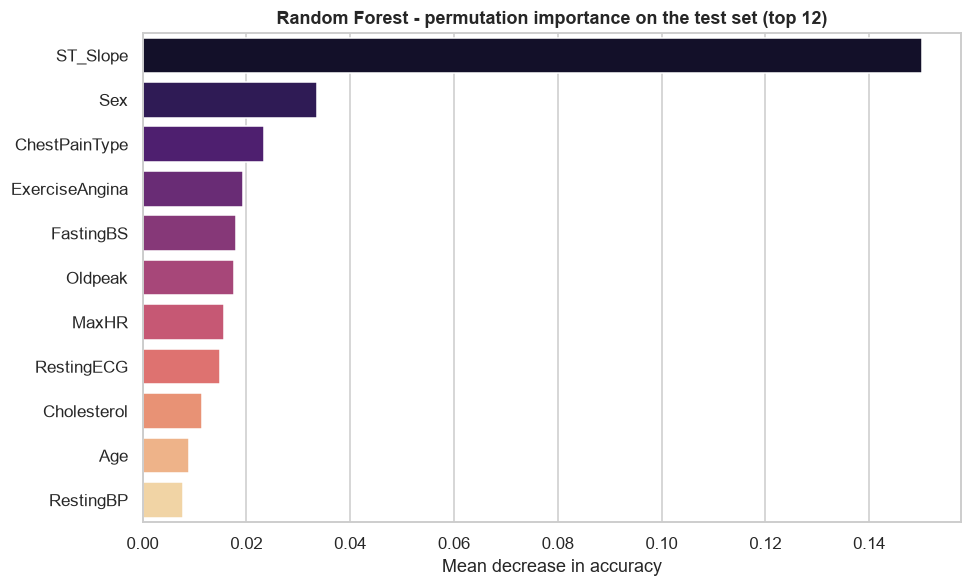

*Figure 13 — Permutation importance on the test set (mean accuracy drop).*

**Interpretation.** `ST_Slope` is unambiguously the dominant predictor in both rankings. An
up-sloping ST segment is protective, while flat or down-sloping segments dramatically increase risk.
`MaxHR`, `Oldpeak`, `ExerciseAngina`, `ChestPainType` and `Sex` form the next tier. Age, fasting
blood sugar and cholesterol contribute smaller amounts; cholesterol is much weaker after the
impossible zeros are corrected. `RestingECG` is consistently unimportant. The logistic coefficients
(`figures/14_logistic_coefficients.png`) confirm the directions: a flat ST slope, male sex,
exercise-induced angina, higher fasting blood sugar and higher `Oldpeak` increase the log-odds of
disease, while a high `MaxHR`, an up-sloping ST segment and the non-`ASY` chest-pain types (ATA, NAP,
TA) decrease it. `ASY` and `Down` are the dropped reference levels, so they appear as the baseline
rather than as separate coefficients.

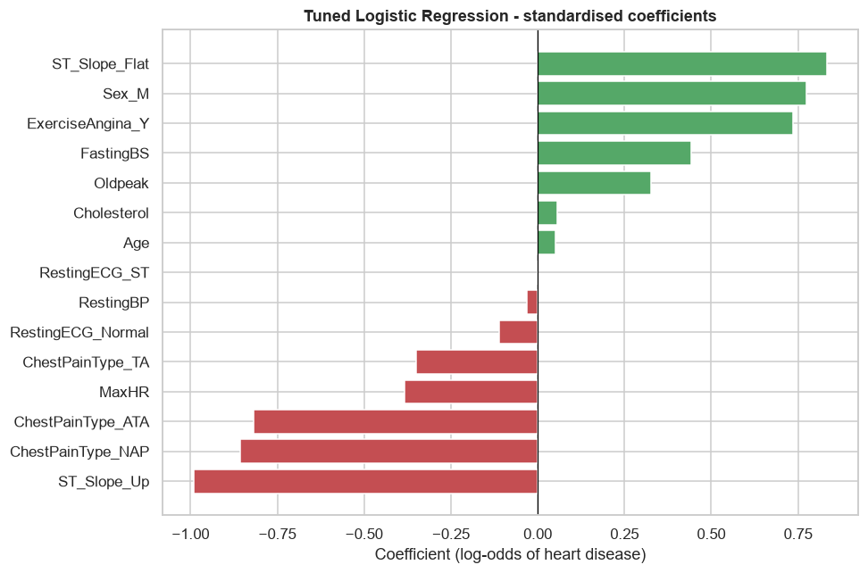

*Figure 14 — Standardised Logistic Regression coefficients (log-odds of heart disease).*

---

## 5. Discussion

### 5.1 Which model performed best?

On the held-out test set, **Logistic Regression** performed best on accuracy (0.8859), F1 (0.8986)
and recall (0.9118), with the second-best AUC (0.9323, behind 0.9430 for Gaussian Naive Bayes).
Under 5-fold cross-validation, **SVM** had the highest mean accuracy (0.8584), with Random
Forest (0.8529) and Logistic Regression (0.8515) close behind. Because the top three are separated
by less than one standard deviation, there is no statistically decisive winner.

**We select Logistic Regression as the final model** for three reasons:

1. It has the best held-out accuracy, F1 and recall.
2. It is the most stable across CV folds (lowest accuracy standard deviation among the top group).
3. Its coefficients are directly interpretable, which matters for a clinical audience.

### 5.2 Why does Logistic Regression perform so well?

After median imputation, one-hot encoding and standardisation, the clinical measurements have a
strong, largely additive relationship with the log-odds of heart disease. In particular, the
ST-slope indicators, `Oldpeak`, `MaxHR` and `ExerciseAngina` already encode the main exercise-stress
signal, and the dataset is close to linearly separable in this transformed space. L2 regularisation
(`C ≈ 1`) controls overfitting on 734 training rows. Random Forest and SVM can model non-linear
interactions, but they do not find additional signal that improves the test result; their similar
ROC-AUC confirms that the simple model captures most of the available predictive information.

The single Decision Tree is much worse because an unpruned tree grows until its leaves are pure,
memorising noise in the training data. Random Forest fixes this by averaging many de-correlated
trees (bagging), which reduces variance and improves generalisation — but not enough to beat the
regularised linear model on this relatively small dataset.

Gaussian Naive Bayes is a useful surprise: despite its independence assumption, it has the highest
ROC-AUC and second-highest test accuracy, because the per-feature class distributions are
sufficiently different to rank patients well. Its lower cross-validation score suggests the test
result is partly favourable noise.

### 5.3 Most important features

The unanimous top signal is **ST slope**, followed by **maximum heart rate**, **ST depression**,
**exercise-induced angina**, **chest-pain type** and **sex**. These are clinically plausible:
exercise-stress ECG behaviour and sex are established risk indicators. **Age** adds a smaller but
consistent contribution. **Cholesterol** and **resting blood pressure** are weaker than their
clinical reputation might suggest, at least in this dataset; the cholesterol result is partly
explained by the large number of invalid zero records. **Resting ECG** carries little unique
information once the other features are known.

### 5.4 The value of domain-aware preprocessing

The cholesterol finding is a concrete example of why EDA and domain knowledge matter. A purely
automatic pipeline would have kept 172 zeros as real cholesterol measurements, concluded that
cholesterol is *negatively* associated with heart disease, and produced a scientifically misleading
report. Marking impossible values as missing changed both the correlation sign and the feature's
importance. This is one of the most valuable lessons of the project.

---

## 6. Limitations

1. **Moderate sample size and single split.** The dataset has 918 patients and the headline metrics
   use a 184-patient test set. A difference of a few patients changes accuracy by 1–2 percentage
   points, so the exact ranking of the top models is uncertain.
2. **Invalid zeros and non-random missingness.** `Cholesterol` is zero for 172 patients, and 152 of
   those are in the disease group. Median imputation is simple but may bias the cholesterol
   relationship; a model that handles missingness natively or a probabilistic imputer could be
   better.
3. **No external validation.** The data combine five cohorts, but the model has not been tested on a
   separate hospital or country.
4. **Limited tuning.** The grid search covered 48 forest configurations and 5 regularisation values;
   SVM and KNN were not tuned in the final notebook, and a wider randomized/Bayesian search could
   find better settings.
5. **Tuning did not improve test performance.** This is not a failure of the method but reflects the
   small, noisy test set; nested cross-validation would give a cleaner estimate.
6. **No probability calibration.** The predicted probabilities are not guaranteed to be
   well-calibrated, so they should not be interpreted as exact individual risk.
7. **No cost-sensitive threshold.** The default 0.5 threshold may not be optimal for screening, where
   false negatives are usually more expensive than false positives.
8. **Missing risk factors.** Smoking status, BMI, diabetes duration, medication, family history and
   lifestyle variables are not available, limiting the achievable performance.
9. **Retrospective labels and selection bias.** The source cohorts may not represent the target
   population.
10. **Clinical use requires regulatory and ethical review.** This model is an academic exercise and
    must not be used for real medical decisions without prospective validation.

---

## 7. Conclusion and Future Work

This project delivered a complete, reproducible machine-learning study of heart-disease prediction.
After domain-aware cleaning and preprocessing, six classifiers were compared with a comprehensive
set of metrics. Logistic Regression achieved the best held-out performance (88.59% accuracy, 0.8986
F1, 0.9323 ROC-AUC), while SVM achieved the best cross-validated accuracy (85.84%). The top models
were statistically indistinguishable, and the simpler, interpretable Logistic Regression was chosen
as the final model. Feature importance consistently highlighted ST slope, maximum heart rate, ST
depression, exercise angina, chest-pain type and sex, matching clinical expectations.

Future work should focus on external validation, additional clinical features, modern gradient-
boosting models, probability calibration, cost-sensitive threshold selection, SHAP-based
explanations, and nested cross-validation. Deploying the saved pipeline behind a small API or
dashboard would make the model usable in a research or educational setting, but prospective clinical
validation would be required before any real-world medical use.

---

## 8. Reproducibility

**Project structure**

```
ml-assignment/
├── data/
│   └── heart.csv                              # 918-patient dataset
├── notebooks/
│   └── Heart_Disease_Prediction.ipynb         # executed notebook (code + outputs)
├── report/
│   ├── Project_Report.md                      # this report
│   ├── Project_Report.html                    # print-ready report
│   ├── Project_Report.pdf                     # PDF version of this report
│   ├── Heart_Disease_Prediction.html          # rendered notebook (code + outputs)
│   ├── results.json                           # all key metrics
│   ├── model_comparison.csv
│   ├── cross_validation.csv
│   ├── final_model_comparison.csv
│   ├── tuning_random_forest.csv
│   ├── tuning_logistic_regression.csv
│   └── figures/                               # all EDA and result figures
├── models/
│   ├── random_forest_tuned.joblib
│   └── logistic_regression_tuned.joblib
├── main.py                                    # runs the notebook end-to-end
├── pyproject.toml
└── README.md
```

**How to run**

```bash
# install dependencies
uv sync

# execute the whole notebook (regenerates all figures and metrics)
uv run python main.py
```

or open the notebook directly:

```bash
uv run jupyter lab notebooks/Heart_Disease_Prediction.ipynb
```

**Environment:** Python 3.14.5, pandas 3.1.1, NumPy 2.5.4, scikit-learn 1.9.1, matplotlib 3.11.2,
seaborn 0.13.2.

---

## 9. References

1. fedesoriano. *Heart Failure Prediction Dataset*. Kaggle.
   https://www.kaggle.com/datasets/fedesoriano/heart-failure-prediction
2. Pedregosa, F. et al. (2011). Scikit-learn: Machine Learning in Python. *Journal of Machine
   Learning Research*, 12, 2825–2830. https://scikit-learn.org/stable/
3. McKinney, W. (2010). Data Structures for Statistical Computing in Python. *Proceedings of the
   9th Python in Science Conference*. https://pandas.pydata.org/docs/
4. James, G., Witten, D., Hastie, T., & Tibshirani, R. *An Introduction to Statistical Learning*.
   Springer.
5. Course lectures, CSE-4115 Machine Learning, BAUET (Lec-05 to Lec-11: classification, Naive Bayes,
   KNN, Decision Tree, SVM and Random Forest).
